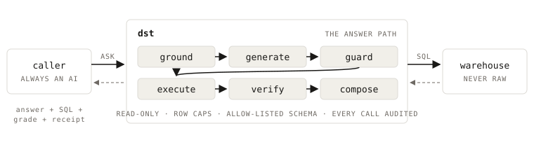

# The answer path



The **answer path** is everything that happens between a question and the
number that comes back. dst owns all of it, so the caller never touches the
warehouse:

```
caller ──▶ dst ──▶ warehouse
agents      lens · context        read-only,
analysts    certified patterns  guarded SQL
apps        receipts · refusal
```

The stages, in order:

1. **Ground.** The question is scoped to one [lens](lens.md), which selects the
   semantic files, governed definitions and [curated context](curated-context.md)
   the model may read. When the caller names no lens, a routing step picks one
   first, or declines. Routing settles what the lenses declare before any model
   is asked: a lens whose `not_for` names the ask, or that the question reads
   closer to one of its `not_for` asks than to anything it covers, is not a
   candidate; a question that is one lens's certified question goes to that
   lens; a question naming a measure a lens declares `not_computable` (or
   one of its aliases) goes to that lens, whose refusal is the answer, or to
   the lens its entry routes to; a question naming a source system some lens
   declares in `sources` goes only to the lenses declaring it, and is
   uncovered, naming the system,
   when no lens the caller may use does.

   The remaining lenses are ranked by similarity, with a lens that declares a
   metric the question names (by its name or `label`) ahead of one that does
   not. Then routing checks **whole-question coverage** on the top three: a
   lens covers the question when every word of it has somewhere to land in
   that lens (a metric's name, label, aliases or description, a field or
   dimension, a stored value, a definition, the period). A word counts against
   a lens only when some lens the caller may use declares it; a word no lens
   declares is left to the routed lens's own checks. A metric named by one
   lens alone routes to that lens without a model call, but only when the
   lens covers the question: "late fees by format" does not go to the one
   lens that declares late fees if that lens has no format. A metric several
   of the top lenses declare and cover is a tie between them: a lens named
   after the asked thing wins, then a table or entity only one of them
   carries, then the only one that can split over time when the question
   asks for that; otherwise the question is asked which lens. Lenses outside
   the top three never make a tie. Otherwise the decider picks over its
   shortlist, shown each lens's metrics, time fields, dimensions and a few
   stored values per dimension, and the question goes to the first lens of
   the decider's pick, then the ranking, that covers it.

   When none of the top three covers the question, the caller gets the
   **explore scope** if it may use one: a lens that exposes tables and
   answers untyped serves it from those tables, described by their
   [blueprints](../guides/project-files.md#table-blueprints-facts-about-a-table), with the `EXPOSED` line on the
   answer, the join, clock and reconciliation checks beside its grain line, and
   `lane: explore` on its request row. Otherwise the question is declined, naming the closest lens and
   the words it has nothing for. When the routed lens refuses because its
   data does not hold what was asked, the question goes to the next lens
   that covered it instead of ending there; a declared refusal (a
   `not_computable` term, a `not_for` ask) is the answer and does not fall
   through. Every routing record lists the lenses tried, in order, and why
   each was passed over or refused.
2. **Match.** If a [certified answer](certified.md) covers the question, its
   approved SQL is served verbatim and generation is skipped.
3. **Check, then generate.** Before generation runs, deterministic code
   [clarifies or refuses](clarify-and-refusal.md) — an ambiguous governed term,
   a metric this lens leaves out. Then the SQL is produced: with a
   [typed-decision provider](typed-decisions.md), every slot of the answer is
   decided over the semantic model and the SQL is compiled from the decisions;
   otherwise the model writes SQL against that curated context. Two rules the
   compiler holds on every compiled answer: a definition's predicate is applied
   only when the question names the term, one of its aliases, or the metric it
   is `about` (a definition the model wanted but the question never named is
   reported on the resolution as `definition_suggested`, not applied); and when
   the metrics asked for read different time fields, each takes the stated
   window on its own field, inside its own aggregate.
4. **Guard.** The SQL is parsed and checked before it runs: single-statement
   and read-only, inside the lens's scope.
5. **Execute** against the warehouse, row-capped at execution. The connection
   itself is opened read-only where the driver supports it (DuckDB, Postgres,
   MySQL); on BigQuery and Snowflake the guard and the credential's own grants
   carry it.
6. **Compose and verify.** The prose is written, then the whole answer is
   graded and returned with the SQL, the confidence grade, and a
   [receipt](receipts.md).

Because every question travels the same path, access, cost, scope and
correctness are enforceable in one place. The alternative is giving the model
warehouse credentials and letting it author its own SQL: a wrong definition
that a person would quietly catch then gets repeated across a thousand
decisions at machine speed, and nobody learns the answer was wrong until
something downstream breaks. Describing the data better informs that model; it
does not limit what its credentials can run.

