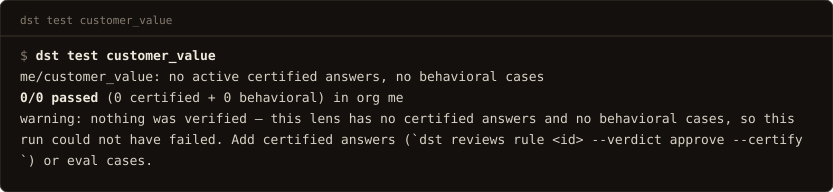
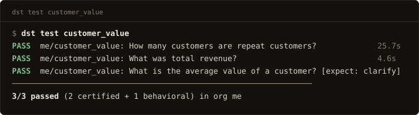
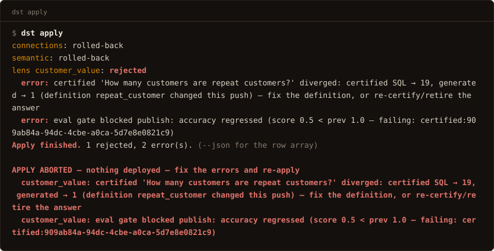

# Evaluation

There is no separate test suite to write. Every active
[certified answer](../concepts/certified.md) **is** a regression test: it pins a
correct value, so certifying an answer and writing its test are the same act. The
suite runs on demand (`dst test`), as a gate inside `dst apply`, and on
whatever schedule your CI or cron gives it.

## The corpus is the suite

For each active certified answer, the stored SQL is the oracle — the
known-good reference the test compares against:

1. Execute the certified SQL, read-only, capped at 1000 rows — and compare
   over at most 1000 rows from either side. Certified answers are small
   verified aggregates, so they fit by construction.
2. Ask the question again through the **real generation path**. Certified
   matching is switched off by construction (testing the serve shortcut would
   trivially pass), and the answer under test is excluded from its own
   examples — with them, it would match itself almost perfectly and the suite
   would be grading copying.
3. Execute what generation produced and compare the two **executed results**
   on the certified projection. Columns match by name: when every certified
   column is present and generation carried more (a label, a helper measure),
   the extras are dropped and the pass says which. Then a set difference,
   ignoring column order, with numbers compared as values: a 1e-9 relative
   tolerance (the order of an aggregation alone can wiggle a floating-point
   number's last bits), a percentage against its fraction (`82.59` and
   `0.8259`), and a generated value that rounds to the certified one at the
   precision the certified value prints with (`82.5912` against `82.59`). A
   pass that needed any of these says so in its reason. One deliberate
   leniency beyond that: when the oracle is a single count of 2 or more, a
   generated result carrying that many rows passes — "how many X" and "which
   X" are the same answer at two grains. Any real failure exits `dst test`
   non-zero.

Both sides run back-to-back against the live warehouse, so there is no
snapshot to drift from: the oracle is the certified SQL run *now*. A diverging
case re-runs generation once before it counts, to absorb model randomness;
flapping that survives the re-run is signal. A divergence prints both executed
values and the choice it forces: *fix the definition, or re-certify/retire the
answer*. A green answer in `dst test` or the apply gate is a
**re-verification**: its bindings — the recorded hashes of the shared assets it
depends on — re-stamp to the current versions.

Generation inputs come from the same assembly seam serving uses (retrieval,
profile enrichment, exemplar folding, generator tiering), so the suite grades
the pipeline production actually runs. Each result records what
was assembled, so a leaner-than-production run (say, no embedding provider
configured) is visible, never silent.

## Running it

```bash
dst test            # every published lens
dst test finance    # one lens
dst test --all      # explicit form of the default
```

Runs in-process against the configured database, like `migrate`: no server,
token, or URL needed. Always the **full** active corpus (the apply gate scopes
to what a push touches; this command is the cron/CI sweep). Exit `1` on any
divergence or failed expectation.

[](../assets/term/test.svg)



Every run is recorded: `dst test` persists the run and its per-case results in
the same tables the publish gate writes, so accuracy is a queryable trend —
`dst runs <lens>` lists the recorded runs, and `dst runs <lens> --diff A B`
compares two (score delta plus per-case flips; exit `1` on a regression).

The run lands in the database `DATABASE_URL` names for the process running
`dst test` (the `--dir` project's `.env`, or the process environment), and the
last lines of the output say so: `recorded: run <id> (<org>/<lens>) in <database>`,
password hidden. `dst runs` and the dashboard read the history through the
server at `DST_URL`. When those two name different databases, the run was
recorded and is not where you are looking: a laptop whose shell points at a
local Postgres while the server runs on another, or a CI job whose throwaway
database lives one run and keeps no history. Compare the `recorded:` line with
the server's `DATABASE_URL`; in CI, keep the `--json` output as a build
artifact or point the job at a durable database when the trend matters.
Once a lens serves real traffic, `dst evals from-traffic <lens>` drafts new
cases from the request log, with the observed outcome shape as the
expectation.
The cadence is yours — run the sweep from CI, cron, or a deploy pipeline
(see [Environments and CI](environments-and-ci.md)); there is no in-process
scheduler to configure.

## Three lanes under typed serving

With a [typed-decision provider](../concepts/typed-decisions.md) configured,
`dst test` grades three different things, each with one owner for its failures:

| lane | compares | a failure belongs to |
|---|---|---|
| **resolution** | the provider's decisions for each certified question against the answer's typed gold — lens, entity, metric, dimension, grain, filter column and value | the layer (option sets, descriptions, readings) or the decider |
| **compile** | the SQL compiled from those decisions against the certified SQL, canonicalised | dst — a layer that does not compile is a product defect, caught at `dst plan` |
| **data** | the certified SQL executed against the warehouse and compared to its stored result | the data: a load, a backfill, a schema change |

The first two need no warehouse and run in seconds per corpus. The third is
the only one that pays warehouse time, and by default it runs only for the
cases the first two could not prove — a case whose compiled SQL is identical
to the certified text is proven without a query.

```bash
dst test                 # resolution + compile for every case; data only for the unproven
dst test --slots         # resolution + compile only — nothing executes
dst test --repeat 20     # each question resolved 20 times; a case passes only when every run agrees
dst test --rows          # execute every case — the data-drift check
```

Answers certified before typed serving carry no typed gold; they grade against
gold attributed from their certified SQL, and a green typed run stores the
typed gold for next time. Attributed gold is the answer's metric: the measures
in the certified SQL's outer projection, matched to declared metrics by column
name, compiled expression or attribution. A column read only inside a filter or
a subquery is not the answer, and neither is the numerator or denominator
projected beside a ratio: SQL that returns opening ARR, its change and NRR over
them grades against NRR.

A compiled SQL proves a case when it is identical or equivalent to the
certified text: equivalent once both are optimised, with aliases (table and
output column), predicate order, a wrapping subquery and a latest-snapshot
subquery's correlated or scalar spelling treated as spelling. One written
another way is `differs`; when the data lane then returns the certified rows it
is reported `differs (data equal)`, never a failure.

The data lane compares rows on what they mean. On a declared time grain (week,
month, quarter, year, from the gold or the typed reading), dated rows match by
bucket: a month certified on its last snapshot day and generated on its first is
the same month, and the pass says `bucket-match:`. Without a grain, only the two
canonical month labels (every row a month start on one side, a month end on the
other) match that way. Two rows that would fold into one bucket stay a failure.

## Behavioral cases: pinning shape

`lenses/<name>/evals/cases.yaml` holds the behavioral cases: cases that pin the
*shape* of a response, not its value. A case declares
`expect: clarify | refuse | answer`, plus an optional `term` — the term a
clarify must name, ignored on the other two shapes.
Each case is asked the way the query door asks it: the server's typed serving
and its decider, the lens's `untyped_fallback`, its certified answers, caps and
answer mode, and the deterministic clarify and exclusion pre-checks, since that
is the behavior being pinned. On a typed-only lens a question that does not type
clarifies in the gate exactly as it does for a caller, so a case pinned to what
the door serves passes. A case passes only if the response comes back in the
expected shape: a clarification, a refusal with no data served, or a data
answer. Shape is the one thing a value
test can't express, and `expect: answer` measures refusal in both directions:
a lens that drifts into refusing an answerable question was previously
invisible unless that question was certified. Approved behavioral cases run
alongside the certified suite in `dst test` and in the gate. (Legacy value
cases with expected SQL are **not scored anywhere**: certified answers are the
regression suite; `dst evals migrate` converts them into certified answers.)

## The gate on publish and apply

`eval_gate: off | warn | block | block_generation` per lens, default `block`:
a certified answer gates by default, the way a dbt test blocks by default. A
fresh lens with nothing certified publishes with a loud "gate SKIPPED" line,
never a refusal. One shared check runs inside interactive publish *and* inside
`dst apply`; apply cannot bypass it. A blocked publish returns `409` with the
score, the bar it was judged against, and the failing cases. Under `warn`, the
same findings surface loudly and publish proceeds. A lens whose files match what
is published, with nothing else in the push changed, is not republished and not
gated: an apply after a clean `dst plan` runs no eval. A probe artifact pushed
again unchanged is no change.

[](../assets/term/apply_blocked.svg)

The gate grades a certified answer by its own evidence. On every push the
**value lane** runs each active answer's approved SQL (a template's first
sample binding) once more and compares the result to its stored
`verified_value`: the value a `--probe-certified` recorded, the one the file
signs, or, for an answer that has none yet, the one the gate records on its
first run and says so. A value that moved is a *restatement* and blocks under
`block`, naming both figures and the three ways out: write the new
`verified_value` in `certified_answers.yaml` (a template: `dst apply
--refresh-samples`), re-author the `sql` so it re-probes, or fix the data. The
case set is the whole active corpus, so the score's denominator does not move
between pushes that leave the corpus alone, and the previous score is the bar
only when a previous run scored the same case set; otherwise the report says
"no previous run" (or "no previous run with this case set") and never
"regressed".

The **generation lane** asks a different question, does generation still
reproduce the approved SQL, and only for the answers whose stored bindings
disagree with the push's asset hashes (staleness picks what to run, which
keeps it cheap). A divergence is reported verbatim with both executed results
and the changed asset, and the certified answer stands: under `block` the
push lands with the divergence on the row, because the certified SQL *is* the
override. `eval_gate: block_generation` blocks on it instead. Either way, a
divergence a team has judged goes in `evals/known_divergences.yaml` beside
`cases.yaml`, one entry per answer with the reason:

```yaml
- id: certified:5c1c…      # or the certified question
  reason: the certified SQL is the override; generation reads the mart
```

The gate reads the file on every push and lists what it covered, so the
override is never retyped on the command line. An entry with no reason covers
nothing. Generation results ride the run under `generation:<id>` for the
record and never move the score.

The audited override still exists for a one-off: `dst apply
--allow-failing-cases certified:<answer id> --reason '…'` (or `--allow-case`)
names the cases it covers and applies only when every failing case is named;
bare `--allow-failing-cases` is blanket; the flag may be repeated or take
several ids. Either way the apply row and the version summary record what was
published past. And the abort is blue/green and atomic: the whole apply rolls
back, the prior versions keep serving, and the staged eval run and binding
re-stamps roll back with it. A rejected apply can never lower the gate's
baseline for the next one.

The answers a push itself lands get fresh bindings, so the staleness selection
never picks them. Instead, certifying tests itself: an answer the apply
**creates or SQL-re-authors** runs through the same suite in the same apply,
generation against the just-stored oracle. A divergence here is an *alert,
never a block*: divergence at certification time can be the point (the
certified answer overrides generation), so the warning names both executed
results and asks you to re-check the oracle if override wasn't the intent.
The self-test is **unconditional**: `eval_gate` governs the publish gate,
never this; applying a certification tests it and alerts, period. Edits that
touch only provenance or status verify nothing new and are not re-tested.

Two things stop it reaching an answer, and both say so out loud with the
*landed untested* nudge toward `dst test`: generation cannot serve the lens at
all (the lens's model does not resolve, no connector), or the apply runs out of
its self-test budget. That budget is wall-clock — `DST_CERTIFY_SELFTEST_BUDGET_S`,
default 120 seconds — because apply holds the org's lock and its transaction open
for the whole run. Read it in answers, not seconds: at roughly 30 seconds per
generation it covers about four, so a larger push lands the remainder untested by
design and `dst test` sweeps them unbounded.

A configured gate that cannot score (no smart-tier model resolves, nothing to
run) stands down **loudly**, with the reason in the publish/apply output, so a
gate that did not run is never mistaken for a gate that passed. One starvation refuses
to stand down at all: under `eval_gate: block` (or `block_generation`), an apply that empties the
active certified corpus — retiring the **last** active answer, or deleting its
file entry — aborts instead of publishing over an emptied corpus. Keep at
least one active answer, or set `eval_gate: warn`/`off` in lens.yaml and
re-apply. Under `warn`, the same ≥1→0 transition publishes but **warns**, in
the apply row itself: even when approved behavioral cases keep the gate
scoring, the certified gate now has nothing left to test. The scope is exactly
the ≥1→0 transition: a lens that never had active answers (a fresh lens doing
its first applies under `block`) is untouched.

## Scored three ways

The suite on this page is pass/fail per case. Where dst measures answer
quality more broadly — the benchmark harness, and Observe's per-lens
columns — it scores three ways (**correct / wrong / declined**), with
wrong-rate as a co-headline, because a wrong answer is worse than no
answer. Declining is the *correct* response for a question whose data does not
exist; a confident number there is a hallucination by construction.

Definitions and exemplars generalize beyond the questions they were written
for: they ground questions whose SQL is *not* in the certified library.
